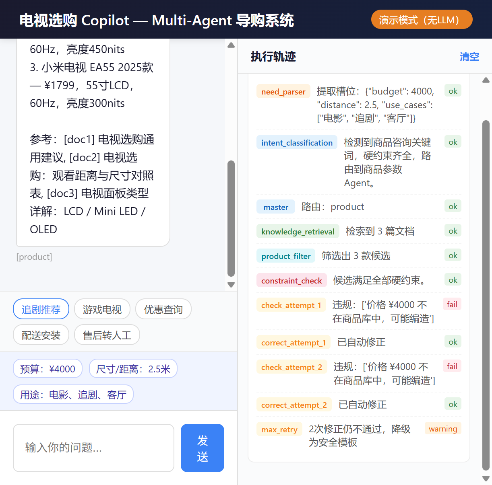

# 智能电视选购 Copilot

> **项目状态：独立原型**
> **我的角色：** 独立完成产品设计、流程设计与代码实现。
> **数据范围：** 知识库为静态样例，评测使用 25 条模拟测试用例；文中指标均来自这组样例。

**👉 [在线体验静态演示](https://alaraby527.github.io/tv-buying-copilot/)**

> 一个面向高客单价家电选购场景的 AI 导购系统。
>
> 效果：25 条模拟评测集驱动的一轮迭代，通过率 V1.0 72%（18/25）→ V1.1 92%（23/25），编造知识库外型号的幻觉从 4 次降到 0 次，异常输入零崩溃。

## 业务背景

家电选购是高客单价、低频次、参数复杂的决策场景。用户在线上选购电视时，面对 Mini LED/OLED、分区数、峰值亮度、HDMI 2.1 等参数，往往需要在商品页、评测文章、客服之间反复切换。传统电商客服只能回答单轮问题，无法完成"需求理解→多品对比→优惠计算→履约确认"的连贯决策链。

## 解决的痛点

1. **参数焦虑**：大部分人分不清 Mini LED 和 OLED 的区别，但又怕被导购忽悠，在知乎、B站、什么值得买之间反复横跳
2. **客服答非所问**：问"PS5 玩 4K 120Hz 哪款合适"，客服只会回复"亲，我们这款支持 4K 哦"，完全不理解具体需求
3. **优惠算不明白**：满减、会员券、以旧换新、国补叠加，用户自己算经常算错
4. **售后信息分散**：包安装吗？挂架收费吗？屏幕保修几年？这些信息散落在各个地方

## 用户调研

访谈了 4 位最近半年内买过电视或正在选电视的朋友：

| 访谈对象 | 购机预算 | 核心痛点 |
|----------|----------|----------|
| A（程序员，租房） | 3000-4000 | "参数太多看不懂，希望有人直接告诉我'这个预算买这款就行'" |
| B（新婚，首套房） | 6000-8000 | "要接 PS5 和 Switch，怕买错接口，客服根本不懂 120Hz" |
| C（给父母买） | 2000-3000 | "父母只看大小和价格，但我担心质量和售后，信息不对称" |
| D（发烧友） | 10000+ | "我自己懂参数，但优惠叠加算不明白，每次都要截图慢慢算"

## 效果

- **通过率提升**：V1.0 72% → V1.1 92%
- **幻觉消除**：编造知识库外型号的情况从 4 次降到 0 次
- **鲁棒性**：异常输入零崩溃
- **可追溯**：回答里每个参数都能给出处，不编造

## 演示

👉 [在线体验静态演示](https://alaraby527.github.io/tv-buying-copilot/)

## 评测报告

- [V1.0 评测报告](evaluation/eval-results-v1.md)
- [V1.1 评测报告](evaluation/eval-results-v1.1.md)

---

## 📜 版权与使用声明

本仓库所有内容（包括但不限于源代码、文档、设计方案、方法论、数据）的著作权归 **Alaraby527** 所有。

### ⚠️ 未经书面授权，禁止以下行为

- ❌ 搬运、洗稿、抹去原作者署名后重新发布
- ❌ 冒称本项目为自己独立开发的原创成果
- ❌ 将本项目用于个人求职作品集、简历、面试展示、竞赛提交
- ❌ 商业使用、闭源修改后分发

### ✅ 允许的行为

- ✅ 个人学习参考、技术交流
- ✅ Issue 讨论、反馈问题
- ✅ 标注原始出处的引用与转载

如需将本项目用于作品集展示、合作开发或商业用途，请先联系作者获取书面授权。

**违反本声明者，作者保留追究法律责任的全部权利，包括但不限于 GitHub DMCA 下架、向招聘方提交侵权证据、民事诉讼。**
